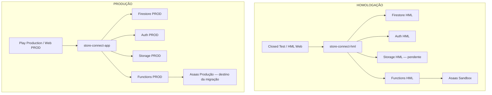

# Store&Connect — Modelo operacional PROD × HML

Visão OPERACIONAL CANÔNICA dos ambientes de Produção e Homologação.

- Referência: 11/10/2026; branch `feat/f7-intelligent-catalog`.
- Commit de referência: `160d67536cfbfbde04768d25e700cee101c5abd4`.
- Esta entrega cria somente documentação. Regras futuras e checklists não constituem implementação concluída ou autorização de execução.
- Valores atuais combinam evidências locais, auditoria B4C e estado informado por Rodrigo. Regiões, billing e provisionamento não foram consultados remotamente nesta entrega.

## 1. Princípio central: separação física

**HML e PROD são ambientes FISICAMENTE separados. HML não é uma cópia de Produção.**

O mesmo commit aprovado pode alimentar ambos, mas Firebase project, apps Firebase, dados, Authentication, Storage, secrets, Asaas, webhooks, schedulers e builds devem permanecer separados. Separação física significa recursos e identidades operacionais distintos; não exige regiões geográficas diferentes.

A existência do projeto HML não comprova que todos os serviços estejam provisionados ou protegidos. As pendências constam na seção 28.

**NUNCA promover um artefato HML diretamente para Produção.** Produção recebe um NOVO build do mesmo código/commit aprovado, explicitamente configurado para PROD.

## 2. Matriz canônica de ambientes

Campos futuros representam o destino da migração, não o runtime atual comprovado.

| Aspecto | PRODUÇÃO — PROD | HOMOLOGAÇÃO — HML |
| --- | --- | --- |
| Firebase project | `store-connect-app` | `store-connect-hml` |
| Project number | `294766590074` | `324469869942` |
| Android package | `com.storeeconnect.app` | `com.storeeconnect.app` |
| Android Firebase App ID | `1:294766590074:android:f993b08bb3f300b2afe3c3` | `1:324469869942:android:4482c313ccd8c0e9ae7e57` |
| Web Firebase App ID | `1:294766590074:web:fbe25231b8ef11d8afe3c3` | `1:324469869942:web:0d50059ae896f7e3ae7e57` |
| Web | https://app.storeconnect.com.br | https://store-connect-hml.web.app |
| Firestore database | `(default)` | `(default)` |
| Firestore location | `southamerica-east1` | `southamerica-east1` |
| Authentication | Email/Password + Google atualmente utilizados | Email/Password habilitado; contas próprias |
| Google Sign-In | Configuração existente; validar por distribuição | Pendente OAuth/SHA |
| Storage atual | `store-connect-app.firebasestorage.app` | Provisionamento pendente; bucket separado obrigatório |
| Storage location atual | `US-CENTRAL1` | Pendente; não inferir a partir do Firestore |
| Asaas futuro | `ASAAS_ENV=production` | `ASAAS_ENV=sandbox` |
| Secret futuro — somente nome | `ASAAS_PRODUCTION_API_KEY` | `ASAAS_SANDBOX_API_KEY` |
| Asaas API | https://api.asaas.com/v3 | https://api-sandbox.asaas.com/v3 |
| Distribuição Android prevista | Google Play Production | Closed Test / debug controlado |

`(default)` não é compartilhado: cada database pertence ao seu projeto. Nomes de secrets não contêm valores de credenciais.

## 3. Arquitetura e fronteiras

Arquitetura de destino; componentes pendentes continuam sujeitos aos gates de migração.



**Nenhuma seta HML → recurso PROD. Nenhuma seta PROD → recurso HML.** A chave privada Asaas permanece no backend do ambiente correspondente, nunca no aplicativo.

## 4. Android: flavors

Flavors atuais: `hml` e `prod`. Ambos mantêm `com.storeeconnect.app`, preservando o mesmo app Google Play. Closed Test e Production são tracks dessa aplicação; o backend muda pelo flavor/configuração, não pelo nome da track.

| Flavor | Source set Firebase | Entrypoint |
| --- | --- | --- |
| `hml` | `android/app/src/hml/google-services.json` | `lib/main_hml.dart` |
| `prod` | `android/app/src/prod/google-services.json` | `lib/main_prod.dart` |

`android/app/google-services.json` **não deve ser recriado como configuração default** nem fallback para contornar erro de flavor.

O App ID histórico `1:294766590074:android:82c38b9f3a34123dafe3c3` é obsoleto e não pertence ao caminho ativo. PROD usa o App ID terminado em `f993b08bb3f300b2afe3c3`.

Com o mesmo package, HML e PROD não coexistem como dois aplicativos independentes no dispositivo. Uma instalação pode substituir a outra quando assinatura e versão permitirem; assinatura diferente pode impedir a substituição. Planejar dispositivos e contas sem apagar dados reais automaticamente.

## 5. Entrypoints e guards fail-closed

- `lib/main_hml.dart` → ambiente `hml` → `store-connect-hml`.
- `lib/main_prod.dart` → ambiente `production` → `store-connect-app`.
- `lib/main.dart` legado falha explicitamente; não seleciona ambiente default.
- `lib/firebase_options.dart` legado não deve voltar a selecionar PROD silenciosamente.

Flavor Android `prod` corresponde ao ambiente Flutter `production`; HML usa `hml`. Não intercambiar essas strings sem respeitar o contrato.

`AppEnvironment` e `firebase_bootstrap.dart` verificam ambiente, projectId e App ID esperados. No Android, flavor Flutter e flavor nativo devem coincidir com o entrypoint. O canal nativo valida projectId/App ID dos recursos Android antes da inicialização; depois, o app Firebase default também é validado. Web valida projectId/App ID do ambiente selecionado. Não é permitido mudar ambiente durante a execução.

Mismatch, canal indisponível ou identidade inesperada interrompe a inicialização antes dos demais serviços e de `runApp`. **Nenhum fallback silencioso para PROD.** Guards não verificam track Play nem convertem artefato HML em PROD. iOS permanece fora da configuração atual e é rejeitado.

## 6. Comandos previstos de build — NÃO executados

SDK oficial: `C:\Users\rodri\develop\flutter_3.32.6`. Selecionar explicitamente o executável aprovado no PowerShell:

```powershell
$flutterProjectSdk = 'C:\Users\rodri\develop\flutter_3.32.6\bin\flutter.bat'

# Android HML
& $flutterProjectSdk build appbundle --flavor hml -t lib/main_hml.dart

# Android PROD
& $flutterProjectSdk build appbundle --flavor prod -t lib/main_prod.dart

# Web HML
& $flutterProjectSdk build web -t lib/main_hml.dart

# Web PROD
& $flutterProjectSdk build web -t lib/main_prod.dart
```

Equivalentes, com o SDK correto:

```text
flutter build appbundle --flavor hml -t lib/main_hml.dart
flutter build appbundle --flavor prod -t lib/main_prod.dart
flutter build web -t lib/main_hml.dart
flutter build web -t lib/main_prod.dart
```

Não usar SDK Flutter global diferente inadvertidamente: o PATH já apresentou incompatibilidade com o package_config do projeto. Confirmar SDK/dependências antes de execução futura autorizada. Android requer signing existente; não expor seu conteúdo.

Outputs podem ocupar caminhos comuns. Arquivar e identificar artefatos por ambiente, commit, versionCode, assinatura e hash; não confiar somente no nome. Outputs Web também devem ser separados e verificados antes de Hosting.

## 7. HML APROVA CÓDIGO, NÃO ARTEFATO

```text
commit aprovado
    ↓
build HML
    ↓
testes
    ↓
aprovação registrada
    ↓
mesmo commit de código aprovado
    ↓
NOVO build PROD, explicitamente configurado para PROD
    ↓
validação PROD
    ↓
release autorizado
```

**Nunca: AAB HML → promoção direta para Production**, mesmo que package/version pareçam compatíveis. Play não deduz Firebase project a partir do package ou track.

Planejar versionCode exclusivo para cada novo upload. Se metadados de versão exigirem alteração versionada, revisar/aprovar essa alteração mínima e manter rastreabilidade ao código homologado. Não tratar um commit diferente como se fosse o mesmo commit aprovado.

## 8. VersionCode e Google Play

Um versionCode usado não pode ser reutilizado para outro novo artefato do mesmo app. Consultar histórico Play antes do release; este documento não define próxima versão real.

Testadores podem receber Produção conforme elegibilidade, compatibilidade e versionCodes disponíveis. Track não é barreira de backend. Planejar sequência e versões para garantir que o dispositivo receba o artefato esperado. Ver [distribuição de testes Google Play](https://support.google.com/googleplay/android-developer/answer/9845334?hl=en).

Antes de qualquer upload futuro:

- [ ] Autorização, app Play e track exatos confirmados.
- [ ] Commit aprovado e working tree de build controlado.
- [ ] Flavor, entrypoint, projectId e App IDs do artefato conferidos.
- [ ] VersionCode inédito e comportamento entre tracks revisados.
- [ ] Upload signing e certificados Play aplicáveis confirmados.
- [ ] Hash e identidade do artefato registrados.
- [ ] Público/dispositivos de teste e substituição de instalação revisados.
- [ ] Production receberá novo artefato PROD, nunca AAB HML.

## 9. Firestore: seed controlado

PROD contém dados reais; HML usa dados sintéticos/controlados. **HML NÃO recebe cópia completa de PROD.** Estratégia: SEED CONTROLADO e revisão antes de importar.

Lojas de teste existentes podem servir de base somente após sanitização. Uma loja chamada “teste” pode conter dados reais e vínculos financeiros; não presumir segurança pelo nome.

Conforme validação, reaproveitar: estrutura de loja, categorias/produtos de teste, clientes fictícios, cenários de vendas simulados e configurações não sensíveis.

Nunca copiar diretamente:

- usuários reais ou UID PROD como vínculo Auth;
- CPF/CNPJ reais ou dados pessoais reais;
- IDs Asaas PROD, subscriptions/payments reais ou URLs de cobrança reais;
- tokens, secrets, material criptografado ou certificados fiscais;
- backups PROD, locks ou idempotency records PROD.

Seed aprovado exige lista de campos permitidos, remoção de referências externas, remapeamento e destino HML explícito. Preferir reconstrução sintética a dumps completos. Validar vínculos, URLs e ausência de dados sensíveis sem imprimi-los.

## 10. Identidades e remapeamento

Exemplo fictício, sem dados reais:

| Campo | PROD ilustrativo | HML |
| --- | --- | --- |
| `storeId` | `teste123` | Definido pela estratégia de seed |
| `ownerUid` | `UID_PROD` | `UID_HML`, conta HML própria |
| `asaasCustomerId` | `cus_prod` | Vazio ou novo ID Sandbox |
| `asaasSubscriptionId` | `sub_prod` | Vazio ou novo ID Sandbox |
| `asaasEnvironment` | Ambiente da origem | `sandbox` |

**IDs financeiros nunca cruzam ambientes.** Mudar somente o campo environment não torna IDs antigos válidos em HML. Remapear dono, permissões, subcoleções e relacionamentos. Decidir preservação/regeneração de IDs internos não autoriza reutilizar UID Auth ou IDs Asaas PROD.

## 11. Authentication

PROD utiliza Email/Password + Google. HML possui Email/Password habilitado e Google pendente de conclusão OAuth/SHA.

Usuários PROD não são copiados para HML. Criar contas HML próprias e vínculos/permissões locais. Mesmo email em projetos distintos não significa mesma identidade nem mesmo UID.

`OAUTH_CONSOLE_CHECK_REQUIRED = SIM`.

Google Sign-In exige configuração OAuth coerente com HML, identidade Android e audiência dos tokens. Habilitar provider sem resolver essas dependências não conclui a integração.

## 12. Google Sign-In / SHA

Certificados distintos:

- **Debug key:** builds debug locais.
- **Upload key:** envio à Play e builds locais configurados com essa chave.
- **Google Play App Signing key:** APKs efetivamente distribuídos pelo Play; pode diferir da upload key.

Upload Key conhecida, conforme identificação operacional fornecida:

`SHA-1: 63:8C:0F:42:C6:FE:B5:9E:78:95:FC:17:39:20:61:5A:18:D3:E4:E9`

**Não assumir Upload Key = Play App Signing Key.** O AAB enviado não determina sozinho o certificado dos APKs distribuídos.

A auditoria B4C somente leitura já foi realizada nesta sessão; a conclusão/configuração permanece NEXT/PENDING. Evidências em 11/10/2026:

| Item | Resultado |
| --- | --- |
| Debug local SHA-1 | `B2:BB:EB:D9:75:45:8A:E3:DA:9B:14:23:AE:92:FE:59:C3:71:38:39` |
| Debug local SHA-256 | `89:61:0B:EA:F4:BB:01:A5:19:8C:9A:65:6F:08:49:F2:7F:EC:7A:77:5B:DF:8C:43:F7:AF:F0:DC:AA:00:91:1A` |
| SHA-1 registrados PROD | Upload Key acima, `05:4B:E6:8A:EC:12:1C:F6:D3:93:80:E2:52:72:DD:A9:6F:30:5C:BB` e `FD:47:E8:BA:1E:E3:99:29:F9:1D:3D:04:F6:5B:B4:24:F9:E6:40:74` |
| HML fingerprints | Nenhum |
| OAuth remoto PROD associado ao app | Três clientes Android e um Web |
| OAuth local PROD | Dois Android e um Web; não inclui o cliente `FD:47:…` visto remotamente |
| OAuth local/remoto HML no config consultado | Ausente |
| Google provider HML | GET retornou 404: não configurado |
| Play App Signing | Não identificado com segurança |

`PLAY_APP_SIGNING_CONSOLE_CHECK_REQUIRED = SIM`.

Conferir Google Play Console → Configuração → Integridade do app → Assinatura de apps → Certificado da chave de assinatura do app → SHA-1 / SHA-256. Comparar com `05:4B:…` e `FD:47:…`, sem presumir que um deles seja obrigatoriamente o certificado vigente. Conferir certificados adicionais, se apresentados.

Package + SHA-1 de cliente OAuth Android deve ser único entre projetos Firebase/Google Cloud. Duplicar em HML os pares existentes em PROD conflita. Para Google Sign-In, a documentação permite autorizar client IDs de projetos externos no provider; isso exige configuração/validação específicas, preservando PROD. Ver [unicidade e clientes externos](https://support.google.com/firebase/answer/6401008?hl=en) e [certificados Play](https://support.google.com/googleplay/android-developer/answer/9842756?hl=en).

Debug HML pode usar seu certificado local após verificar unicidade. Closed Test exige identificar o certificado Play e resolver OAuth sem apagar clientes PROD. Package ou assinatura HML distintos exigiriam outra decisão arquitetural. Não adicionar SHA automaticamente para testar colisão.

Web HML requer cliente OAuth Web próprio do projeto HML e relação correta com Firebase Auth Google provider. Origem prevista: `https://store-connect-hml.web.app`. AuthDomain atual: `store-connect-hml.firebaseapp.com`; callback: `https://store-connect-hml.firebaseapp.com/__/auth/handler`. Se adotar `store-connect-hml.web.app` como authDomain, autorizar também `https://store-connect-hml.web.app/__/auth/handler` e validar o fluxo. O domínio HML deve estar nos authorized domains do Auth. Não misturar com a configuração PROD de `https://app.storeconnect.com.br`. Ver [Google Auth Web](https://firebase.google.com/docs/auth/web/google-signin) e [redirects web.app](https://firebase.google.com/docs/auth/web/redirect-best-practices).

Sequência futura: confirmar Play; resolver conflitos/autorizações; registrar certificados permitidos; habilitar provider; obter config HML atualizado; validar flavor/config; testar debug e Closed Test. Nenhum passo foi executado por este documento.

## 13. Storage

PROD usa o bucket real `store-connect-app.firebasestorage.app`, location atual informada `US-CENTRAL1`. HML exige bucket separado; provisionamento ainda pendente.

Não copiar objetos PROD automaticamente. HML usa imagens sintéticas, logos de teste, QR Codes de teste e arquivos próprios de homologação. QR Codes não podem apontar para cobranças reais.

Nunca reutilizar download tokens PROD, URLs Storage PROD ou backups PROD. StorageBucket declarado no SDK config não comprova existência do bucket ou prontidão das rules.

`HML_STORAGE_CONFIG_REFRESH_REQUIRED = SIM`: após criação autorizada, revalidar bucket, SDK config HML, rules e referências do seed. Não assumir mesma região do Firestore.

## 14. Functions

Functions PROD/HML devem ser deployadas separadamente. Toda operação futura identifica explicitamente o projeto; não depender de default implícito.

Aliases recomendados para implementação futura aprovada:

| Alias futuro | Projeto |
| --- | --- |
| `prod` | `store-connect-app` |
| `hml` | `store-connect-hml` |

Este documento não altera `.firebaserc` nem comprova aliases já configurados. Conferir resolução antes de usar; preferir project ID explícito em operações críticas.

Deploy inicial HML deve ser seletivo, com exports/dependências revisados. Não publicar automaticamente todos os exports de `functions/index.js`, que incluem operações financeiras, destrutivas e agendadas. Selecionar export não substitui auditoria de inicialização dos módulos, secrets e guards.

## 15. Asaas: separação crítica

| Ambiente | Seleção futura | Secret futuro — nome | API |
| --- | --- | --- | --- |
| HML | `ASAAS_ENV=sandbox` | `ASAAS_SANDBOX_API_KEY` | https://api-sandbox.asaas.com/v3 |
| PROD | `ASAAS_ENV=production` | `ASAAS_PRODUCTION_API_KEY` | https://api.asaas.com/v3 |

Hoje, `ASAAS_API_KEY` ainda existe no código como compatibilidade temporária durante a transição. Isso não comprova que Firebase PROD já opere com Asaas Produção.

**B5 deve eliminar essa ambiguidade**, separar bindings de secrets e adicionar guard projeto × ambiente. Revisar consumidores antes de remover compatibilidade. O Flutter não escolhe livremente ambiente financeiro: a decisão vem da configuração segura do backend.

## 16. Fail-closed Asaas

O resolver atual aceita somente strings exatas, sem normalizar espaços ou capitalização:

| `ASAAS_ENV` | Resultado |
| --- | --- |
| `sandbox` | Aceito: endpoint Sandbox |
| `production` | Aceito: endpoint Produção |
| Ausente | FAIL |
| Vazio | FAIL |
| `Sandbox` | FAIL |
| ` sandbox ` | FAIL |
| `foo` | FAIL |

Nenhum fallback silencioso. A validação atual ainda não equivale ao guard completo projeto × ambiente × secret.

Proteção futura B5:

| Combinação | Regra de destino |
| --- | --- |
| `store-connect-hml` + `sandbox` + secret Sandbox | Permitida após validação |
| `store-connect-hml` + `production` ou secret PROD | BLOQUEAR |
| `store-connect-app` + `production` + secret Production | Permitida após migração aprovada |
| `store-connect-app` + `sandbox` | Futuramente BLOQUEAR após transição concluída |
| Projeto inesperado, secret ausente ou combinação incoerente | BLOQUEAR |

Exceção transitória deve ser explícita, limitada e rastreável. Não interromper fluxo atual sem plano de transição aprovado.

## 17. Secrets

Secret Manager é a fonte operacional. HML usa secret Sandbox próprio; PROD usa secret Production próprio. Secrets jamais são copiados entre projetos sem decisão explícita.

Nunca armazenar valores em Git, `firebase.json`, Dart, `google-services.json` manualmente, documentação ou Drive em texto puro. Nunca incluir em APK/AAB/JavaScript Web, logs ou evidências. Nomes de secrets e IDs públicos não são seus valores.

Planejar acesso mínimo, bindings por Function e rotação. Validar ambiente da credencial sem imprimi-la; mudar o nome do secret não comprova origem da chave.

## 18. Webhooks

Arquitetura futura:

```text
Asaas Sandbox    → webhook HML  → store-connect-hml
Asaas Production → webhook PROD → store-connect-app
```

Nunca compartilhar endpoint sem validação de ambiente. Preferir endpoints e autenticação separados. O payload não pode selecionar livremente outro projeto/credencial.

Contrato: autenticação própria, environment validation, validação de vínculo financeiro, idempotência por eventId dentro do ambiente, proteção contra duplicidade/concorrência e tratamento de ordenação/retry. Reentrega não pode duplicar efeitos financeiros.

A implementação atual ainda precisa evoluir para o contrato completo de isolamento. Isso não afirma ausência de todos os controles atuais; auditar e preservar os existentes antes de alterar handlers.

## 19. Schedulers

| Scheduler | Risco a revisar |
| --- | --- |
| `syncAsaasSubscriptionPrices` | Alteração/sincronização financeira |
| `reconcileAsaasBilling` | Reconciliação e vínculos financeiros |
| `checkOverdueSubscriptions` | Estado por inadimplência |
| `expireTrials` | Expiração e alteração de acesso |
| `scheduledStoreBackups` | Dados, Storage e consumo |
| `scheduledBackupRetention` | Exclusão/retenção e consumo |

**HML schedulers começam DESABILITADOS/protegidos.** É regra de ativação futura; estado remoto dos jobs não foi inventariado nesta entrega.

Nenhum scheduler deve ficar ativo automaticamente porque Functions foram deployadas. Antes de publicar export agendado, definir guard por projeto/ambiente, habilitação explícita, limites e escopo dos dados. Sem proteção comprovada, excluir do deploy inicial.

Operações financeiras, destrutivas, de retenção, reconciliação e alteração de assinatura exigem guard explícito. Pausar job não corrige efeitos anteriores; preservar evidências e revisar reprocessamento.

## 20. App Check

Separar configuração e validação de App Check PROD/HML. Debug providers/tokens não devem ser utilizados inadvertidamente em Produção.

Evidência em `lib/app_bootstrap.dart`: ativação atual com `AndroidProvider.debug`, `AppleProvider.debug` e `ReCaptchaV3Provider('debug')`, sem seleção por ambiente nesse trecho. Falhas são capturadas e a inicialização continua. Não considerar App Check PROD pronto apenas por existir chamada de ativação.

Revisão de provider, enforcement, configuração Web e comportamento de falha é pendência de release. Estado remoto de enforcement não foi comprovado aqui. Nenhum código foi alterado.

## 21. Hosting e links

| Finalidade | URL |
| --- | --- |
| PROD | https://app.storeconnect.com.br |
| HML inicial | https://store-connect-hml.web.app |
| HML futuro possível, não provisionado por este documento | https://hml.storeconnect.com.br |
| Institucional comum | https://www.storeconnect.com.br |

Links operacionais, incluindo catálogo, devem usar configuração de ambiente. Link institucional pode permanecer comum quando não representa backend/ambiente; essa exceção não autoriza apontar dados HML a endpoints PROD.

Hosting deve receber output Web correto. Confirmar conteúdo, projeto e domínio alvo; outputs podem ser sobrescritos pelo build seguinte.

## 22. Firebase.json / FlutterFire — B4B

B4B removeu metadata FlutterFire histórico obsoleto de `firebase.json`, preservando Hosting, Functions, Firestore e Storage. O commit `160d67536cfbfbde04768d25e700cee101c5abd4` foi criado/enviado anteriormente; esta entrega não cria outro commit.

Não executar `flutterfire configure` genericamente nem reconfigure com metadados antigos. A configuração atual é flavor-aware: futuras execuções devem preservar `prod`/`hml`, projetos, App IDs, source sets, opções Dart, entrypoints e guards.

Não restaurar `android/app/google-services.json` raiz ou fallback legado Dart. Remover metadata antigo não impede que configure genérico futuro recrie defaults incorretos.

Detalhes técnicos/histórico: [P5_1_1_B4A_ENVIRONMENT_SPLIT.md](P5_1_1_B4A_ENVIRONMENT_SPLIT.md).

## 23. Billing

Estado informado por Rodrigo: HML foi colocado em Blaze; existe pendência financeira da billing account a resolver no próximo dia útil. Orçamento global da billing account já existe. Esses fatos não foram reconsultados nesta entrega.

Enquanto a pendência estiver aberta, **NÃO avançar com recursos dependentes/geradores de consumo quando isso representar risco**. Blaze não equivale a disponibilidade financeira ou liberação de consumo. Confirmar resolução antes de desbloquear provisionamentos/deploys afetados.

Criar posteriormente, mediante autorização, budget específico `store-connect-hml`, com alertas e responsáveis. Budget de alertas é monitoramento, **não hard cap universal**. Avaliar spend caps específicos para serviços/contas compatíveis, especialmente no planejamento de Functions, confirmando cobertura/disponibilidade reais. Limites de escala não equivalem a teto absoluto da conta.

Referências: [budgets e alertas](https://docs.cloud.google.com/billing/docs/how-to/budgets) e [spend caps e cobertura](https://docs.cloud.google.com/billing/docs/how-to/budgets-spend-caps). Nenhum budget, cap ou billing foi alterado.

## 24. Deploy: alvo explícito

**TODO deploy deve informar projeto explicitamente.** Nunca executar `firebase deploy` sem saber e declarar o alvo; default do terminal não é evidência suficiente.

Antes de qualquer deploy futuro autorizado:

1. Confirmar branch/commit aprovados, baseline e escopo.
2. Confirmar environment do artefato/backend.
3. Confirmar Firebase project e resolução de alias, se usado.
4. Confirmar secrets, bindings e disponibilidade sem expor valores.
5. Confirmar Asaas environment e coerência projeto × ambiente × secret.
6. Confirmar schedulers desabilitados/protegidos ou autorizados.
7. Confirmar rules/indexes e impacto nas permissões/consultas.
8. Confirmar billing, pendências e controles de consumo.
9. Confirmar tests, regressões e validações aplicáveis.
10. Confirmar rollback e monitoramento.

Usar `--project store-connect-hml` ou `--project store-connect-app` e escopo seletivo aprovado. Deploy/publicação exige autorização explícita; o documento não a fornece. Rollback deve manter ambiente, preservar dados e respeitar versionCode Play. Não trocar backend HML/PROD como contorno de falha.

## 25. Release checklist HML

Marcar somente com evidência; documentação não executa estes itens.

- [ ] Commit aprovado e rastreável.
- [ ] Flavor `hml`.
- [ ] `lib/main_hml.dart`.
- [ ] `projectId = store-connect-hml`.
- [ ] Firebase App ID HML correspondente à plataforma.
- [ ] Auth HML e contas próprias.
- [ ] Storage HML provisionado, config revalidado e rules corretas.
- [ ] Asaas Sandbox.
- [ ] Secret Sandbox próprio e bindings corretos.
- [ ] Webhook Sandbox isolado e validado.
- [ ] Schedulers seguros, desabilitados/protegidos conforme escopo.
- [ ] Dados sintéticos e seed sanitizado/remapeado.
- [ ] Google Sign-In HML validado; pendências OAuth/SHA resolvidas.
- [ ] Emulator regression aprovada em execução futura autorizada.
- [ ] Build smoke test aprovado.
- [ ] VersionCode, assinatura e artefato HML identificados.
- [ ] Billing apto ao escopo de teste.
- [ ] Closed Test validado no dispositivo, confirmando backend HML.

## 26. Release checklist PROD

- [ ] Código/commit aprovado no HML, com evidências.
- [ ] NOVO build PROD; nenhum artefato HML promovido.
- [ ] Flavor `prod`.
- [ ] `lib/main_prod.dart`.
- [ ] `projectId = store-connect-app`.
- [ ] Firebase App ID PROD correspondente à plataforma.
- [ ] Asaas `production` após transição aprovada.
- [ ] Secret Production próprio e bindings corretos.
- [ ] Webhook Production validado.
- [ ] Schedulers Production revisados/autorizados.
- [ ] Firestore PROD e rules/indexes validados.
- [ ] Storage PROD, URLs e rules validados.
- [ ] Auth PROD e vínculos corretos.
- [ ] Google Sign-In PROD com assinatura de distribuição validado.
- [ ] App Check adequado; sem debug inadvertido.
- [ ] VersionCode correto e inédito para novo artefato.
- [ ] Signing correto.
- [ ] Upload Key correta.
- [ ] Play App Signing e certificados aplicáveis validados.
- [ ] Hash, commit e ambiente do artefato registrados.
- [ ] Smoke tests aprovados, sem efeitos financeiros não autorizados.
- [ ] Billing, monitoramento e rollback revisados.
- [ ] Autorização de publicação e rollout controlado.

## 27. Incidentes / fail-safe

**Se houver dúvida sobre ambiente: PARAR. Não tentar “corrigir” automaticamente.**

Abortar quando houver:

- build HML apontando para PROD;
- build PROD apontando para HML;
- HML com secret PROD;
- PROD com secret Sandbox após migração;
- webhook cruzado;
- IDs Asaas de ambiente errado;
- scheduler sem guard;
- Firebase project inesperado;
- mismatch flavor/entrypoint.

Preservar baseline, artefato e evidências minimizadas; identificar alvo real e solicitar decisão quando houver ambiguidade. Não alternar default, copiar secrets ou remover guards para liberar execução.

Em incidente financeiro, conter novas operações inseguras conforme procedimento autorizado, preservar rastreabilidade e reconciliar no ambiente correto. Correção de dados, IAM, billing, revogação ou rollback remoto exige escopo/autorização próprios; não é consequência automática deste documento.

## 28. Estado atual da migração

Consolidado em 11/10/2026. DONE vale apenas para o escopo indicado, não para prontidão geral de release.

| Etapa | Escopo | Status | Observação |
| --- | --- | --- | --- |
| P5.1.1-B1 | Firebase HML criado | DONE | `store-connect-hml` |
| B2B1 | Firestore HML | DONE | `(default)`, `southamerica-east1` |
| B2B2 | Auth Email/Password | DONE | Contas HML próprias |
| B2B3 | Storage | PENDING | Provisionar e revalidar config |
| B3 | Android/Web Firebase Apps | DONE | Identidades na matriz |
| B4A | Split HML/PROD | DONE | Flavors, entrypoints e guards locais; não equivale a build validado |
| B4B | FlutterFire metadata | DONE | Commit de referência criado/enviado anteriormente |
| B4C | OAuth/SHA | NEXT/PENDING | Auditoria realizada; conferência Play e configuração pendentes |
| B5 | Secrets por ambiente + project/env guard | PENDING | `ASAAS_API_KEY` transitório |
| Webhook | Isolamento/validação por ambiente | PENDING | Evolução do contrato atual |
| Schedulers | Isolamento/ativação segura HML | PENDING | Não assumir estado remoto |
| Seed sanitizado | Dados HML e remapeamento | PENDING | Sem cópia integral PROD |
| Emulator regression | Regressão antes de deploy | PENDING | Testes locais de ambiente não substituem |
| Billing issue | Pendência financeira da conta | PENDING EXTERNAL | Próximo dia útil, conforme informado |
| App Check | Prontidão por ambiente | PENDING | Providers debug existentes exigem revisão |

Respeitar dependências: resolver billing quando bloquear consumo; concluir OAuth/SHA e Storage; preparar B5 e proteções de integradores/jobs; aprovar seed e regressões; considerar deploy/build/release somente com autorização específica. DONE isolado não desbloqueia automaticamente a próxima operação.

## 29. Referências e manutenção

A visão operacional canônica é este documento. Os existentes permanecem técnicos/históricos, sem cópia integral de seus contratos:

- [P5.1.1-B4A — split e reconciliação FlutterFire](P5_1_1_B4A_ENVIRONMENT_SPLIT.md).
- [P5 — Preparação de Produção Asaas](../financeiro/P5_PREPARACAO_PRODUCAO_ASAAS.md).

Atualizações devem registrar evidência, data e escopo; distinguir planejado, configurado, testado e publicado. Revalidar fatos sujeitos a mudança antes da operação. Divergência com runtime/estado remoto exige interromper a ação e resolver a causa, sem editar silenciosamente o ambiente para ajustá-lo ao texto.

## 30. Limites da entrega documental

Somente este Markdown foi criado. Não altera código, configuração Firebase, secrets, OAuth, SHA, Auth, Storage, Functions, Asaas, Billing ou Google Play. Não executa seed, scheduler, Emulator, testes de código, build, deploy, stage, commit ou push.

IDs públicos Firebase e fingerprints públicos podem constar; valores de API keys, tokens, passwords, client secrets e material privado jamais devem ser registrados.
